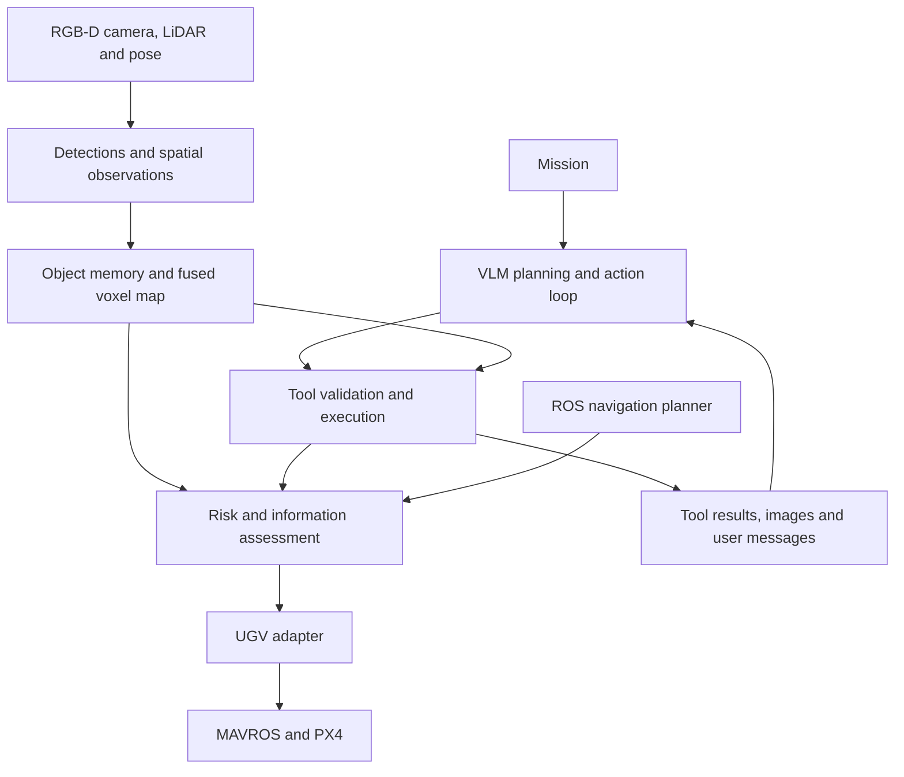

# ALPACA

**Adaptive Layered Polymodal Agent for Cognitive Action**

## Intro

ALPACA is an experimental Python framework for embodied agents. It connects natural-language mission reasoning with perception, spatial memory, action assessment, and vehicle control. A vision-language model proposes tool calls; the surrounding system grounds those calls in sensor observations and evaluates movement before passing it to a vehicle adapter.

The current vehicle implementation targets a ROS 1 ground rover. The framework separates vehicle-specific behavior from mission reasoning through tool, world-model, and vehicle-adapter interfaces.

**Current research question:** How should a robot select additional viewpoints and combine their observations so that the probability of falsely declaring a planned motion safe stays below a specified level when measurement errors are correlated across viewpoints?

## What ALPACA does

- **Mission reasoning:** alternates planning and structured JSON actions, incorporating tool results and images into subsequent model requests.
- **Object memory:** tracks detected objects and their locations using image detections, depth, and vehicle pose.
- **Spatial mapping:** maintains camera and LiDAR voxel observations and a fused occupancy representation.
- **Action assessment:** evaluates navigation requests against the world model and can seek additional observations when information is insufficient.
- **Vehicle interaction:** exposes navigation, inspection, scanning, image capture, and state queries as tools.
- **User interaction:** requests input and reports mission completion through the ROS-based user interface.

The example rover application uses the mission “Find the apple behind the board.” Adapt its mission, detected classes, and model paths in `src/alpaca/run.py` to your task.

## Architecture



The active entry point uses `CRIAVLMInterface`. CRIA provides HTTP transport between ALPACA and a model host, with an Ollama-backed host implementation in `src/cria/localrillm.py`. Model inference can run on a separate GPU machine from the rover's ROS processes.

## Installation

Use Python 3.11 or newer for development installs, plus pip and Git. The v0.3 release supports Python 3.10 or newer. The distribution is named `alpaca-robotics`; import it in Python as `alpaca`. The core installation includes the tool framework and CRIA transport. Add `--rover` for the Python dependencies used by perception and navigation.

Download the installer and run it in your chosen Python environment:

```bash
curl -fsSL https://raw.githubusercontent.com/Neptunium69/ALPACA/dev/install.py -o install.py
python install.py
```

With no selection argument, the installer uses **GitHub's latest published stable release**, rather than the development branch. Select a release, commit, or branch explicitly when needed:

```bash
python install.py --release v0.3
python install.py --commit FULL_COMMIT_SHA
python install.py --branch dev
```

Replace `FULL_COMMIT_SHA` with the full 40-character commit hash. `--release` takes an exact tag name; the selection arguments are mutually exclusive. The chosen revision must contain the packaging files.

Additional options:

| Option | Purpose |
| --- | --- |
| `--rover` | Install the Python perception/navigation dependencies. |
| `--no-deps` | Install ALPACA while keeping your existing dependencies. |
| `--dry-run` | Show the selected source without installing it. |
| `--no-build-isolation` | Build using setuptools already installed in the environment. |

For example, `python install.py --release v0.3 --rover` selects the rover dependencies for that release. Re-running the installer replaces ALPACA with the selected revision, including when two commits share the same package version. GitHub API access can optionally use `GITHUB_TOKEN`.

For local development:

```bash
git clone --branch dev https://github.com/Neptunium69/ALPACA.git
cd ALPACA
python -m pip install -e .
```

Use `python -m pip install -e ".[rover]"` to include rover dependencies. Install the appropriate CUDA-enabled PyTorch build for your machine before adding these dependencies; the installer preserves already-satisfied dependencies.

### Rover environment

The current rover integration uses ROS 1 Noetic, MAVROS, PX4 position targets, RGB-D perception, LiDAR localization, and ROS navigation. Configure the following components for your rover:

| Component | Setup required |
| --- | --- |
| ROS environment | ROS 1, MAVROS, navigation, sensor drivers, and compatible Python bindings such as `cv_bridge`. |
| ALPACA messages | Build and source the catkin package in `ros1/alpaca_msgs`, also installed under `<Python environment>/share/alpaca_msgs`. |
| Perception | Supply compatible detector weights, RGB-D calibration, LiDAR data, and vehicle pose. |
| Model inference | Run a compatible model service and configure the CRIA connection. |
| Vehicle integration | Configure frames, footprint, sensor transforms, navigation, and the flight-controller connection for the actual rover. |
| Application resources | A default mission prompt is bundled. Configure your detector weights and model service for the task. |

`requirements-ros.txt` contains NumPy and OpenCV compatibility pins for the ROS integration. Match the Python environment and binary libraries to your target ROS installation, including the `cv_bridge` NumPy ABI.

## Usage

Build an agent around the tools, world models, and vehicle interfaces your task requires. The supplied rover application demonstrates how these components fit together; you can extend or replace them for other tasks and platforms.

### Define and execute a tool

A tool exposes a `ToolSpecification` and a `run` method that accepts a `Command` and produces a `Return`. Register it in a `ToolList`, then use `ToolExecutor` to validate and dispatch JSON commands:

```python
from alpaca.tools import Command, Return, ToolArgument, ToolExecutor, ToolList, ToolSpecification

class Echo:
    specification = ToolSpecification(
        name="echo",
        description="Return a text message.",
        arguments=[ToolArgument(name="text", required=True, type="str")],
        tag="query",
    )

    def run(self, command: Command) -> Return:
        return Return(command.id, command.command_type, "Success", {"text": command.arguments["text"]})

tools = ToolList()
tools.add(Echo())
executor = ToolExecutor(tools)
results = executor.run('{"commands":[{"id":"echo_1","command_type":"echo","arguments":{"text":"Hello, ALPACA!"}}]}')
print(results[0].results["text"])
# Hello, ALPACA!
```

Replace the example behavior with a sensor query, an application operation, or an action through your vehicle interface. The specification describes the tool to the agent and declares its accepted arguments. Execution rules can constrain tool categories; the default executor permits at most one `action`-tagged command per batch.

### Connect your application

- **Tools:** register the operations available to your agent through `ToolList` and `ToolExecutor`.
- **World models:** expose task-relevant state and queries through `WorldModelInterface` and its registry.
- **Vehicle adapters:** expose platform-specific capabilities through `VAInterface` and its registry.
- **Model inference:** connect the planning/action loop to a model host through `CRIAVLMInterface`.

Use `src/alpaca/run.py` as an example of assembling the model interface, tools, world models, and vehicle adapter.

### Configure the example rover

The active entry point reads these environment variables:

| Variable | Purpose |
| --- | --- |
| `CRIA_URL` | HTTP(S) address of the inference host. Set this explicitly for your machine. |
| `CRIA_MODEL` | Model identifier; defaults to `qwen3-vl:4b-instruct-q4_K_M`. |
| `CRIA_TIMEOUT` | Request timeout in seconds; defaults to `600`. |
| `CRIA_TOKEN` | Optional bearer token for the inference host. |
| `ALPACA_LOG_DIR` | Application log directory; defaults to `/tmp/alpaca_runtime`. |
| `ALPACA_SYSTEM_PROMPT` | Optional path to a custom system prompt; otherwise uses the checkout prompt when present or the bundled default. |
| `ALPACA_YOLO_MODEL` | Detector weights or engine path. |
| `ALPACA_MODEL_PATH` | Optional local model path supplied to the model interface. |

In `src/alpaca/run.py`, configure `user_prompt`, the object classes passed to `ObjectWorldModel`, and the detector/model paths together. Changing a mission does not automatically train a detector or add support for new object classes.

## Existing Features

### Example rover tools

The rover tool set below is an exemplar, not an exhaustive list of ALPACA's possible capabilities. Add, replace, or combine tools to suit your agent's task. Each supplied tool has an implementation and a description in `src/alpaca/tools/<tool>/specification.md`.

| Tool | Purpose |
| --- | --- |
| `query` | Retrieve known objects, optionally filtered by ID or class. |
| `robot_state` | Read vehicle state exposed by the adapter. |
| `observe` | Capture the current camera image. |
| `write` | Add an object grounded in an image bounding box and depth. |
| `navigate` | Assess and execute navigation to a coordinate goal. |
| `inspect` | Select an object-relative observation destination and inspect its surroundings. |
| `scan` | Observe surrounding headings and report object-map changes. |
| `image` | Orient toward an object-derived direction when needed and capture an image. |
| `ask_user` | Send a message and wait for user input. |
| `finish` | Report completion and end the mission loop. |

Commands use a JSON envelope:

```json
{"commands":[{"id":"query_1","command_type":"query","arguments":{}}]}
```

The executor validates command structure and tool arguments before dispatch. Tool returns contain `id`, `command_type`, `status`, and `results`. Individual tools provide further checks through the world model and vehicle interfaces.

The viewpoint-selection and observation-fusion research described above is ongoing. Current occupancy and object-confidence scores are evidence measures; they do not by themselves establish the specified false-safe probability bound.

## Source Layout

```text
src/
  alpaca/
    run.py                 Mission configuration and application assembly
    vlminterface.py         Planning/action loop and model interactions
    worldmodel.py          Object memory and voxel world models
    risk.py                Action assessment and information gathering
    vehicleadapter.py      UGV sensors, state and movement
    yolo.py                Detection and object localization
    depth.py               Camera/depth geometry
    userinterface.py       ROS user interaction
    tools/                 Tool implementations and specifications
    wmtools/               World-model registry and interface
    vatools/               Vehicle-adapter registry and interface
    resources/             Bundled mission prompt
  cria/                    HTTP inference transport and host
ros1/alpaca_msgs/           Custom ROS message definitions
pyproject.toml             Package metadata and dependency extras
install.py                 Latest-release, tag and commit installer
```

## Current work

MoC is an experimental effort exploring cognition and memory through PyTorch-based `Cognition` and spatial spiking `Memory` components, coordinated asynchronously. It is under development and is not part of the rover mission loop.

Development packages include MoC and its PyTorch dependency. **MoC is excluded from v0.3.** Prepare the separate release source with `python scripts/prepare_v03_release.py ../ALPACA-v0.3`; build and tag that snapshot rather than the development checkout.

## Versions and contributions

The latest development code is on `dev`. See [GitHub releases](https://github.com/Neptunium69/ALPACA/releases) for historical versions. When reproducing an experiment or reporting a bug, record the exact revision with `git rev-parse HEAD`.

**Anyone who wants to contribute must contact the maintainer, [@Neptunium69](https://github.com/Neptunium69), before starting work or submitting a pull request.** Open a [GitHub issue](https://github.com/Neptunium69/ALPACA/issues) describing your proposed contribution to discuss its scope and approach first.

For bug reports, include your commit, environment, reproduction steps, expected behavior, and relevant logs. For robot behavior, specify simulation or hardware and include the vehicle and sensor configuration. Remove credentials and personal data from shared logs.

Keep agreed contributions focused and describe how they were validated.

## License

ALPACA's original code is licensed under the [Apache License, Version 2.0](LICENSE).

Third-party libraries, model weights, and datasets retain their respective licenses. This license does not replace their terms, including the applicable AGPL-3.0 or commercial terms for the Ultralytics integration.
